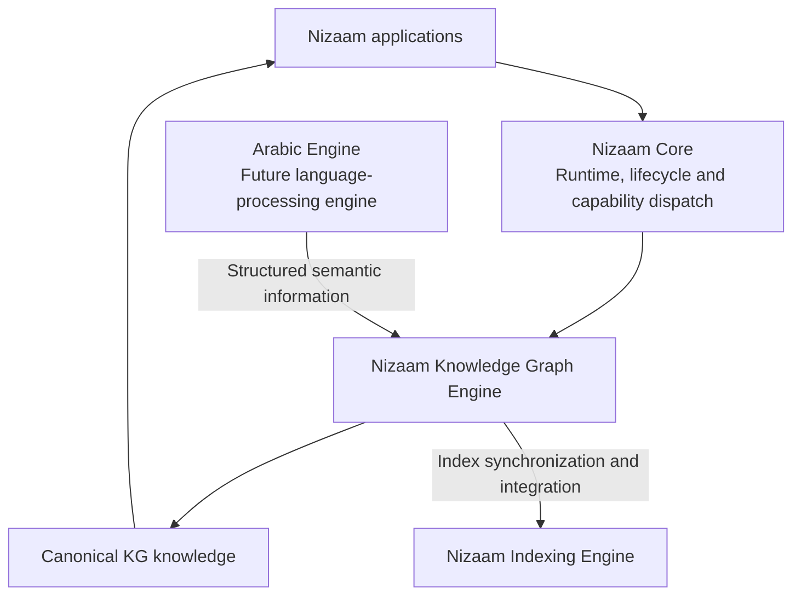
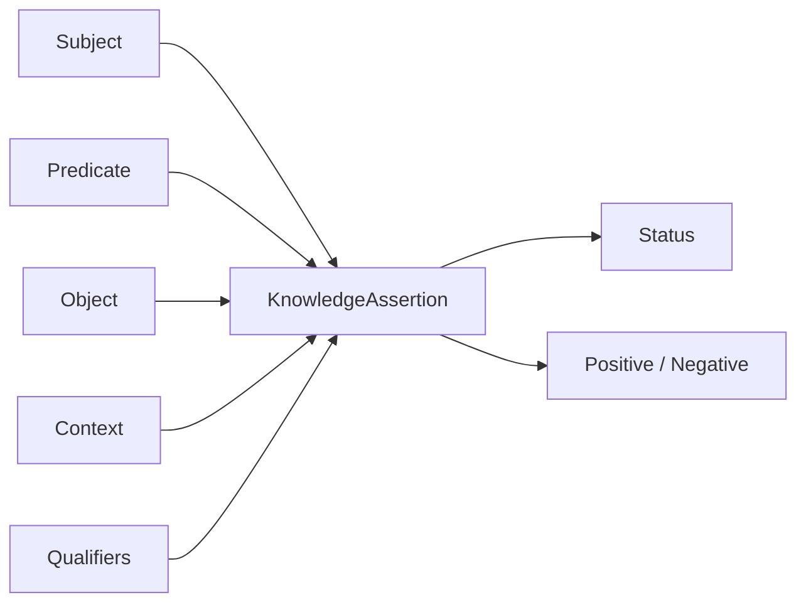
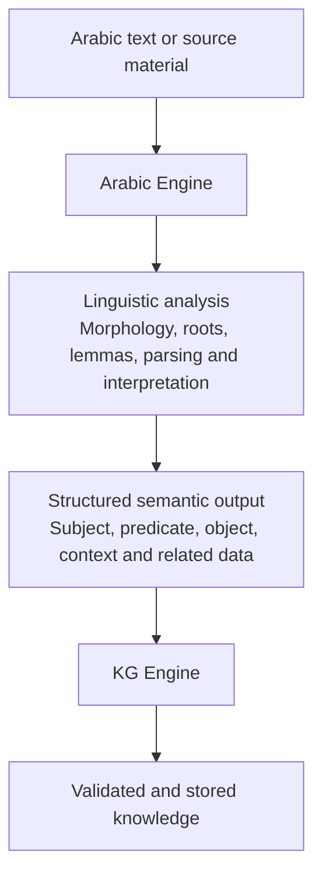
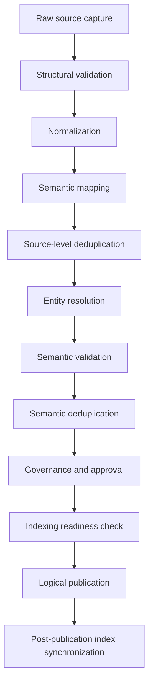
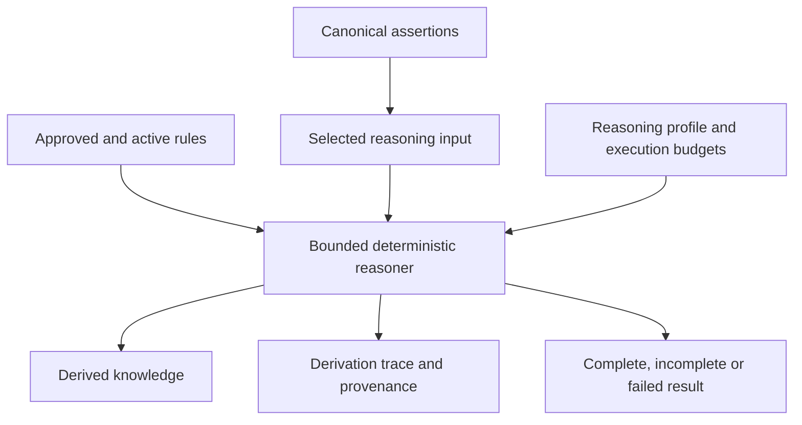
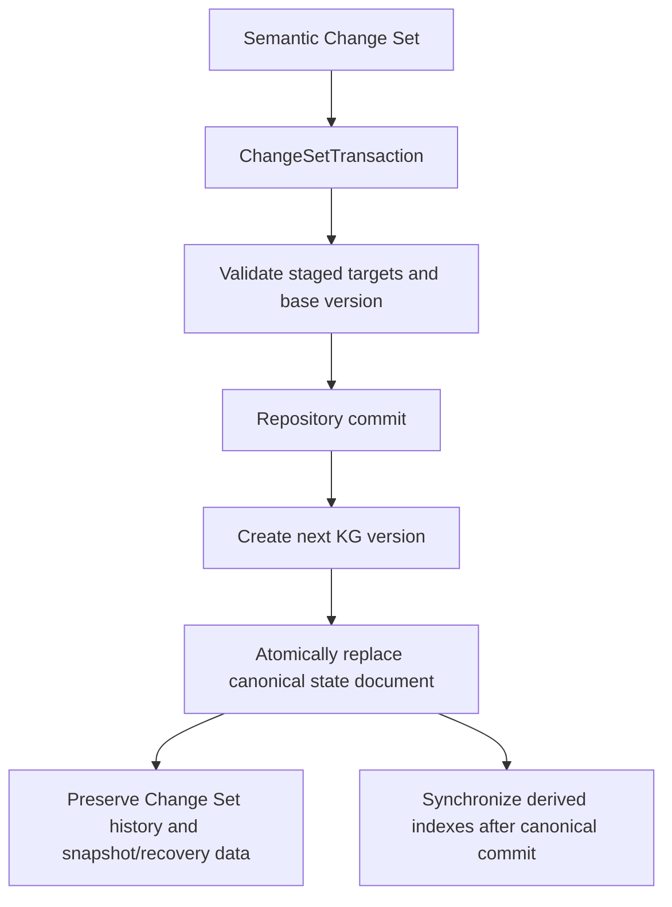
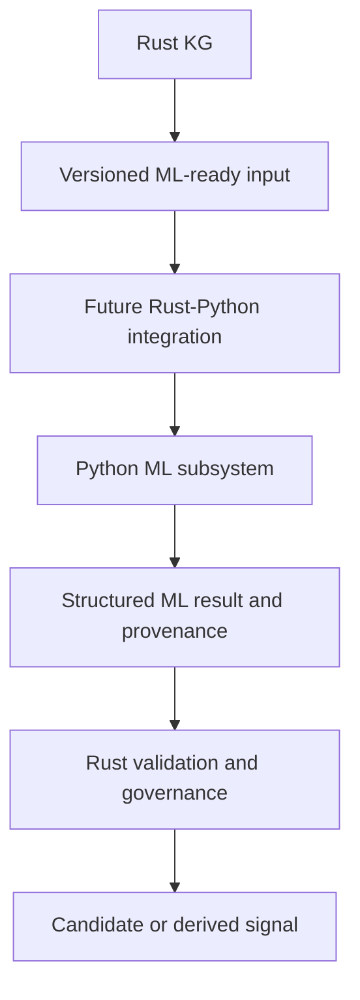

# Nizaam Knowledge Graph Engine

The Nizaam Knowledge Graph Engine is the knowledge foundation of the Nizaam ecosystem. I am building it so that Nizaam applications can work with connected, well-structured knowledge instead of maintaining isolated pieces of information in separate places.

I do not want this engine to be just a collection of graph nodes and edges. A piece of knowledge should have an identity, a meaning, a source, supporting evidence, a time context, and a clear relationship with other knowledge. The engine is designed to preserve those distinctions as the knowledge base grows.

The Rust implementation is the authoritative owner of canonical KG knowledge. Other engines can provide information or additional capabilities, but they should not silently change the meaning or ownership of the canonical knowledge stored here.

## 1. Where the KG Engine fits

The KG Engine is one part of the wider Nizaam architecture. It relies on Nizaam Core for shared engine infrastructure, while keeping knowledge-specific behavior inside the KG.



The responsibilities are intentionally separated:

- **Nizaam Core** owns shared runtime behavior, lifecycle management, engine registration, request admission, execution context, and capability dispatch. The KG adapts to Core instead of implementing another global runtime or Control Plane.
- **The KG Engine** owns knowledge representation, identity, relationships, validation, governance, canonical storage, querying, and controlled reasoning.
- **The Arabic Engine** will be responsible for Arabic linguistic processing. It will send structured information to the KG; Arabic grammar analysis does not belong inside this engine.
- **The Indexing Engine** provides the separate Nizaam indexing infrastructure. The KG also maintains its own derived retrieval structures, but those structures do not replace canonical KG state.
- **The Python ML layer** is a future subsystem. Rust remains responsible for deciding whether an ML result can be accepted as knowledge.

The Arabic Engine is not connected to this repository yet. The diagram shows the intended boundary, not a currently working integration.

## 2. What I mean by knowledge

I keep different kinds of information as different semantic objects. This avoids treating every item as a generic graph node.

### Entities

An `Entity` represents an identifiable referent. It has a canonical identity and a primary `Name`, and it can also have aliases and source-scoped external identifiers.

For example, at the current stage I can represent the Arabic word `صبر` as an entity:

```rust
use nizaam_knowledge_graph::{Entity, EntityId, Name};

let sabr = Entity::new(
    EntityId::generate(),
    Name::new("صبر", "ar"),
    Vec::new(),
);
```

This stores the text and its language tag. It does **not** determine whether the word is a noun or a verb, find its root, derive its lemma, analyze its morphology, or choose a linguistic sense. Those tasks belong to the future Arabic Engine.

### Concepts

A `Concept` represents an abstract idea or meaning. I keep it separate from an `Entity` because a named referent and an abstract concept are not necessarily the same thing. An ontology `Class` is also a different type: it describes classification structure, rather than replacing a concept.

### Knowledge Assertions

The central unit for expressing a fact or claim is `KnowledgeAssertion`. It represents a proposition using a subject, predicate, and object, with additional context and qualification where needed.



The subject and object are typed references. They can refer to entities, concepts, sources, references, lexical-form identities, or mentions. This keeps the relationship between an identity and its semantic category explicit.

A few design details matter:

- A positive assertion and a negative assertion are different propositions. Missing information is not treated as a negative claim.
- Context and qualifiers can change the meaning of a proposition, so they participate in its semantic identity.
- The assertion's review or epistemic status can change without changing the underlying proposition's identity.
- Evidence, provenance, authority, confidence, contradiction, and temporal validity remain separate models. They are not collapsed into one untyped metadata field.

The current KG can store `صبر` as an `Entity` without inventing a `KnowledgeAssertion` for it. Once the Arabic Engine exists, it can provide structured subject-predicate-object information that the KG can represent as assertions.

## 3. The language-processing boundary

I am keeping the KG independent of Arabic grammar so that the same knowledge engine can receive structured knowledge from different upstream systems.

The intended flow is:



The KG should not duplicate the Arabic Engine's work. It should receive the structured result, check and map it against its own semantic model, preserve the relevant source and evidence information, and manage it as knowledge.

The codebase currently defines a `LexicalFormId`, but it does not yet provide a concrete `LexicalForm` object or implement lemma, root, sense, morphology, or Arabic parsing behavior. This is intentional. Those details should be designed with the Arabic Engine rather than guessed inside the KG.

## 4. How knowledge enters the KG

I do not want external information to become canonical knowledge simply because it was received. The ingestion layer defines a controlled path for taking a source record, mapping it into KG objects, validating it, and deciding whether it can be published.



Each stage has a specific purpose. Normalization makes input consistent without claiming to understand every language. Mapping turns source records into typed KG candidates. Entity resolution helps determine whether a candidate refers to an existing canonical entity or should remain separate. Validation checks whether the candidate and its relationships satisfy KG rules. Governance applies the required approval decision before publication.

The pipeline also tracks candidates and ingestion runs separately. A failure for one candidate does not automatically mean that every other candidate in the run has failed. Stage versions and configuration versions provide a basis for controlled reprocessing.

**Logical publication and physical persistence are separate steps.** The `PublicationCoordinator` checks the candidate, semantic subgraph, validation and approval results, source-authenticity information, and the required Indexing readiness acknowledgement. It returns a publication record. It does not itself write the canonical repository document or commit a storage transaction. The storage layer owns that separate operation.

## 5. How the KG organizes and retrieves knowledge

Once knowledge is represented, the engine provides several ways to connect and work with it.

### Relationships and graph traversal

A `KnowledgeAssertion` expresses the proposition. The graph layer provides a navigable representation of the connected semantic objects and assertions. Relationship definitions preserve direction and characteristics, while traversal supports forward and inverse navigation without requiring every inverse relationship to be stored as a separate fact.

Traversal is bounded. Callers can provide limits such as maximum depth, edges, and results so that a graph walk cannot expand without control.

### Ontology and semantics

The ontology layer provides classes, properties, constraints, and taxonomy structures. The semantics layer provides meanings, interpretations, semantic types, and context-related structures. Entity resolution is a separate capability that generates and ranks candidates using configured signals; it does not turn a possible match into a confirmed identity without an explicit decision.

### Sources, evidence, and trust

I keep the origin and quality of knowledge visible because two assertions can make the same claim while having very different support.

- **Sources and references** identify where information came from.
- **Evidence and evidence-support links** describe what supports an assertion and how it supports it.
- **Provenance and lineage** record how knowledge was produced or changed.
- **Authority and reliability** describe the relevant source or process authority.
- **Confidence and uncertainty** express an epistemic assessment; they are not the same as authority.
- **Contradictions** allow incompatible claims to be represented rather than silently deleting one side.
- **Temporal validity** describes when a claim applies. It is distinct from the time when the KG recorded or changed it.

Keeping these dimensions separate allows the KG to explain not only what it knows, but also where a claim came from and how it should be interpreted.

### Query and retrieval

The query layer separates a request from its execution. It supports three main request categories:

1. **Lookup** for a specific semantic object.
2. **Traversal** for following relationships through the graph.
3. **Retrieval** for finding relevant knowledge using the requested retrieval mode.

The planner creates a typed query plan. Execution uses a `QueryAccess` boundary, so the query model does not need to know which physical repository or index implementation supplies the data. Filters, ranking, pagination, and result explanations are represented explicitly. Index access can be optional or preferred depending on the plan; it is an access path, not the source of truth.

## 6. Controlled reasoning

The reasoning layer can derive additional assertions from existing knowledge, but it is deliberately constrained. It does not freely invent facts and it does not run as an unrestricted side effect of normal graph traversal.



Rules have lifecycle and scope. Reasoning profiles determine which rule families and budgets are available. Execution is bounded by limits such as depth, expansion, and time. Derived knowledge carries a derivation trace so the engine can explain which rules and input assertions produced it.

I preserve three different categories:

- Explicit knowledge that was provided and accepted.
- Derived knowledge produced by approved deterministic rules.
- ML predictions or exploratory signals produced by a model.

These categories must not be treated as interchangeable. A pattern discovered by a model is not automatically a fact, and a derived assertion should remain identifiable as derived knowledge.

## 7. How canonical knowledge is stored

The storage design separates the semantic repository from the physical document provider. The repository works with semantic targets, Change Sets, versions, snapshots, and transactions. The initial physical provider is file-backed.

By default, the file-backed repository uses the Nizaam hidden directory in the current user's home folder:

```text
~/.nizaam/
├── kg/
│   └── current-state.json
├── recovery/
│   └── journal.jsonl
└── indexes/
    ├── forward.json
    ├── reverse.json
    ├── search.json
    └── ...
```

The initial repository stores the current canonical KG state in one document, `kg/current-state.json`. That document contains the KG version, semantic repository records, and Change Set history. The current implementation does not create one physical file for every entity or assertion. A repository record associates a typed semantic target with an opaque document payload; the repository itself does not interpret the payload as an `Entity` or `KnowledgeAssertion`.

A change is committed through a versioned transaction:



The transaction checks its base KG version before committing. If the repository has moved on, the transaction receives a version conflict rather than overwriting newer state. The file-backed implementation uses an exclusive lock and an atomic document replacement for canonical commits. Snapshots and a recovery journal provide additional recovery mechanisms.

The `indexes/` area contains derived forward, reverse, and search structures used to accelerate access. These are separate from canonical KG state. A stale or unavailable derived index must not be mistaken for the canonical knowledge itself.

### Storage modes

The storage lifecycle can be selected with `NIZAAM_STORAGE_MODE`:

| Value | Behavior |
| --- | --- |
| `development` | Default mode. Retains generated atomic-write artifacts for local inspection. |
| `production` | Removes current-operation staging artifacts and ages out old generated atomic-write artifacts under the configured retention policy. |

The mode controls generated storage artifacts; it is not a command to delete canonical KG data. Canonical state, recovery data, snapshots, index data, and the lock file are not treated as disposable atomic-write artifacts.

## 8. Rust and Python responsibilities

Rust is the authoritative implementation of KG semantics and canonical state. Python is reserved for machine-learning workloads that operate on approved KG representations.

The intended relationship is:



Python must not write directly to canonical KG storage. A model result is an input to KG validation and governance, not an automatic knowledge write.

I am not building unsupervised models yet. The KG needs real, useful data before those models can be trained or evaluated meaningfully. The current priority is to develop the Arabic Engine, establish the structured input boundary, and begin accumulating actual knowledge data.

## 9. Project structure

The source tree is organized by responsibility rather than by one large graph implementation:

| Area | Responsibility |
| --- | --- |
| `entity/`, `concept/`, `assertion/` | Core semantic objects and propositions |
| `identity/` | Strongly typed identities for KG objects |
| `relationship/`, `graph/` | Relationship meaning, graph structure, and traversal |
| `ontology/`, `semantics/`, `resolution/` | Classification, interpretation structures, and entity matching |
| `source/`, `evidence/`, `provenance/` | Source material, support, origin, and lineage |
| `authority/`, `uncertainty/`, `temporal/` | Trust, epistemic state, contradictions, and validity over time |
| `ingestion/` | Candidate processing, validation, governance, and publication |
| `query/`, `index/` | Query planning and execution, plus derived retrieval structures |
| `reasoning/` | Approved rules and bounded deterministic inference |
| `storage/`, `versioning/` | Persistence, transactions, snapshots, recovery, and KG versions |
| `contract/`, `engine/`, `integration/` | Core capability and cross-engine boundaries |
| `ml/`, `python/` | Reserved future ML contracts and Python workspace |

This structure is intended to keep semantic behavior, physical persistence, runtime integration, and future ML work from becoming tightly coupled.

## 10. Current implementation boundaries

The Rust source tree contains the main KG foundations through controlled reasoning: semantic objects, assertions, relationships, ontology and semantics, resolution, evidence and provenance, ingestion and governance, queries and traversal, persistence and versioning, derived indexes, and bounded reasoning.

Some important capabilities are intentionally not part of the current implementation:

- The Arabic Engine and its linguistic processing pipeline are not included in this repository.
- The KG does not implement Arabic grammar, morphology, root extraction, lemmatization, parsing, or word-sense disambiguation.
- A concrete lexical-form model is not implemented yet; the current lexical module exposes the identity boundary only.
- The Python ML runtime, trained models, and working Rust-Python gRPC integration are not ready for use.
- Full cross-engine Nizaam integration and production hardening remain separate work.

The crate is designed to be library-first. The current `src/main.rs` is only a minimal executable placeholder, not a production KG server.

## 11. Building and testing

The Rust crate uses the 2024 edition. From the repository root, run:

```bash
# Compile the crate
cargo build

# Run unit and integration tests
cargo test

# Check formatting
cargo fmt --all -- --check

# Run Clippy
cargo clippy --all-targets -- -D warnings
```

The test suite is organized around semantic objects, identity, assertions, graph behavior, ingestion and governance, query and indexing boundaries, storage and recovery, reasoning, and negative-boundary cases. Tests are intended to verify both the expected behavior and the places where one subsystem must not take responsibility from another.

## 12. The principle behind the design

I want the KG Engine to remain a dependable knowledge system, not a language processor, a general-purpose workflow engine, or an ML model that decides facts on its own.

The boundary I am working toward is straightforward:

- The Arabic Engine interprets Arabic language and produces structured semantic information.
- The KG Engine validates, maps, connects, governs, stores, queries, and reasons over that information.
- Nizaam Core provides the shared engine infrastructure.
- The Indexing Engine provides its separate indexing infrastructure.
- Python ML can later discover patterns in real KG data, while Rust remains responsible for canonical knowledge.

That separation is what will let the Nizaam ecosystem grow without making every engine responsible for everything.
